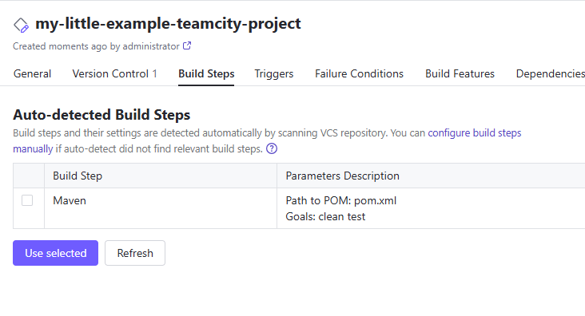
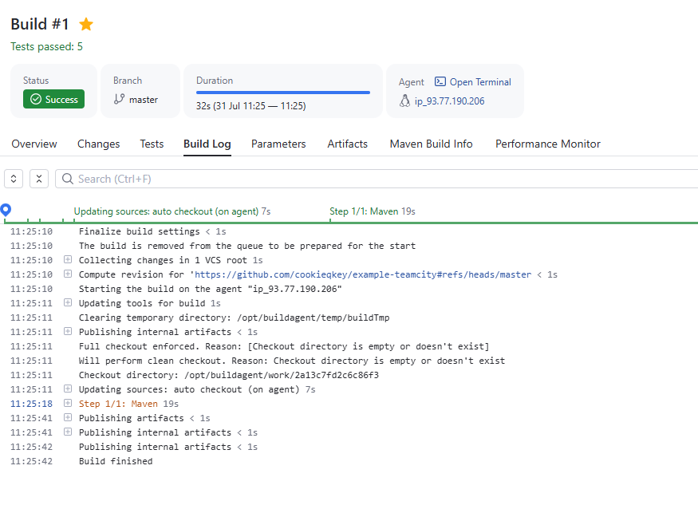
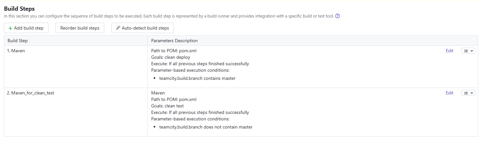
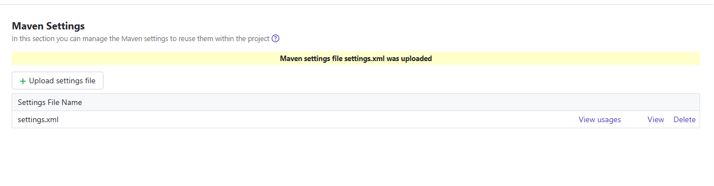
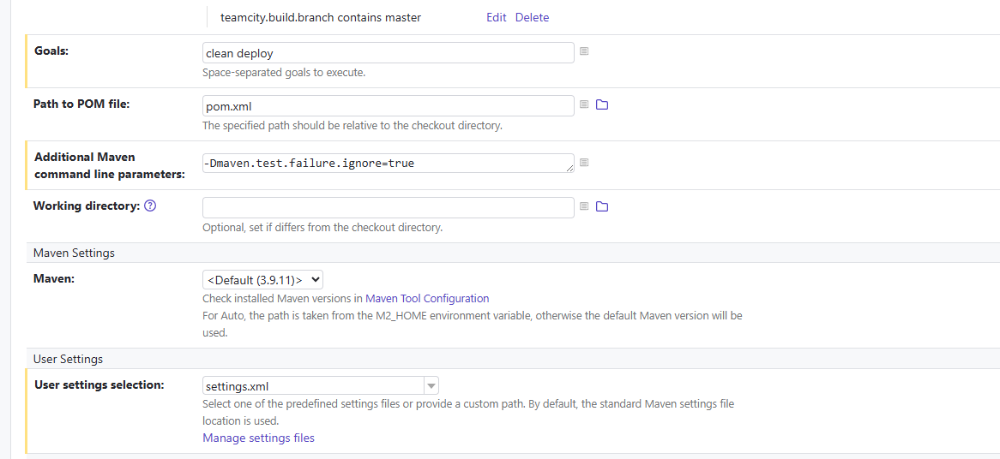
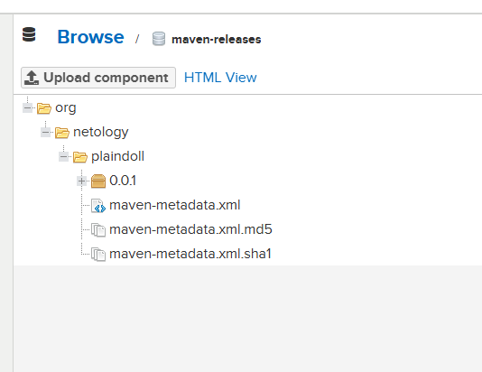
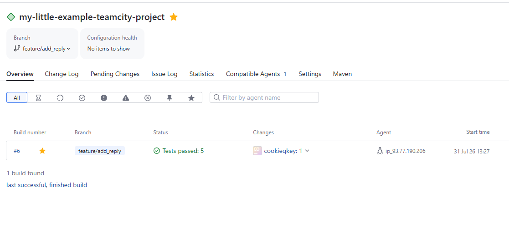

# Задачи

*Сделайте autodetect конфигурации.*

*Сохраните необходимые шаги, запустите первую сборку master.*

*Поменяйте условия сборки: если сборка по ветке master, то должен происходит mvn clean deploy, иначе mvn clean test.*

*Для deploy будет необходимо загрузить settings.xml в набор конфигураций maven у teamcity, предварительно записав туда креды для подключения к nexus.*

*Запустите сборку по master, убедитесь, что всё прошло успешно и артефакт появился в nexus.*

*Убедитесь, что сборка самостоятельно запустилась, тесты прошли успешно.*

