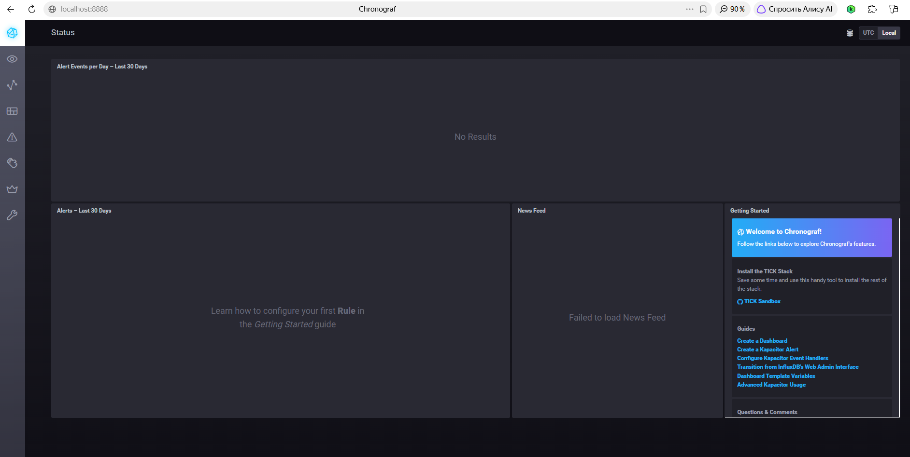
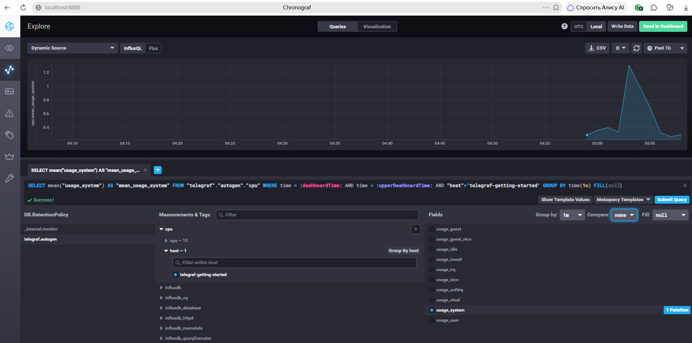
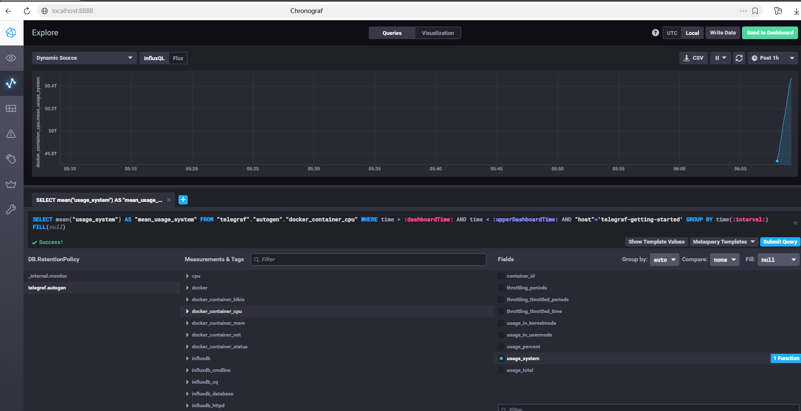

# Задачи

*1. Вас пригласили настроить мониторинг на проект. На онбординге вам рассказали, что проект представляет из себя платформу для вычислений с выдачей текстовых отчетов, которые сохраняются на диск. Взаимодействие с платформой осуществляется по протоколу http. Также вам отметили, что вычисления загружают ЦПУ. Какой минимальный набор метрик вы выведите в мониторинг и почему?*

Для такой платформы я бы разделил метрики на ресурсные, метрики приложения и метрики доступности.

Минимальный набор:

- CPU — загрузка процессора. Вычисления нагружают CPU, поэтому важно понимать текущую загрузку и наличие дефицита вычислительных ресурсов;
- RAM — использование оперативной памяти, т.к. память также является критичным системным ресурсом;
- Disk space — свободное место на диске;
- Inodes — количество свободных inode, т.к. большое количество файлов может привести к исчерпанию inode и невозможности создать новый файл;
- HTTP request rate — количество HTTP-запросов в единицу времени, позволяет понимать нагрузку на платформу;
- HTTP response codes — количество ответов 2xx, 4xx, 5xx. Позволяет определить успешность обработки запросов и наличие ошибок;
- HTTP latency — время обработки HTTP-запросов;
- Доступность сервиса — результат периодического HTTP health-check. Это позволяет понять, доступна ли сама платформа для клиентов.

*2. Менеджер продукта посмотрев на ваши метрики сказал, что ему непонятно что такое RAM/inodes/CPUla. Также он сказал, что хочет понимать, насколько мы выполняем свои обязанности перед клиентами и какое качество обслуживания. Что вы можете ему предложить?*

Менеджеру продукта не обязательно показывать технические метрики вроде CPU, RAM и inode напрямую, ему важнее бизнесовые показатели и качество сервиса:

- SLO. Целевой уровень качества обслуживания. Целевое значение или диапазон значений.

Например:

99,9% HTTP-запросов должны завершаться успешно;
95% запросов должны выполняться менее чем за 2 секунды;
доступность сервиса — не менее 99,9%.

- SLA. Соглашение об уровне обслуживания. Явный или неявный контракт с внешними пользователями, включающий в себя последствия невыполнения SLO.

Например, сервис должен быть доступен 99% времени;

- SLI. Индикатор качества обслуживания. Конкретная величина предоставляемого обслуживания.

Например, доля успешных запросов, средняя/процентная величина latency, или доступность сервиса;

*3. Вашей DevOps команде в этом году не выделили финансирование на построение системы сбора логов. Разработчики в свою очередь хотят видеть все ошибки, которые выдают их приложения. Какое решение вы можете предпринять в этой ситуации, чтобы разработчики получали ошибки приложения?*

Систему перехвата ошибок, например Sentry;

*4. Вы, как опытный SRE, сделали мониторинг, куда вывели отображения выполнения SLA=99% по http кодам ответов. Вычисляете этот параметр по следующей формуле: summ_2xx_requests/summ_all_requests. Данный параметр не поднимается выше 70%, но при этом в вашей системе нет кодов ответа 5xx и 4xx. Где у вас ошибка?*

Ошибка заключается в предположении что все ответы, которые не являются 4xx/5xx, являются 2xx. Например, 30% занимают 3xx;

*5. Опишите основные плюсы и минусы pull и push систем мониторинга.*

**Pull**

При Pull система мониторинга сама периодически обращается к объекту мониторинга и забирает метрики.

Например:

Prometheus → HTTP GET → application /metrics

***Плюсы:***

проще контролировать, откуда и когда получаются метрики;
мониторинг сам определяет частоту опроса;
проще обнаружить недоступность target — если endpoint не отвечает, это уже отдельный сигнал;
не требуется постоянное соединение от приложения до системы мониторинга;
удобно для Kubernetes и динамической инфраструктуры.

***Минусы:***

система мониторинга должна иметь сетевой доступ ко всем target;
сложнее работать с объектами за NAT/firewall;
короткоживущие сервисы могут завершиться до того, как мониторинг успеет забрать метрики;
большое количество target может увеличивать нагрузку на систему мониторинга.

**Push**

При Push само приложение/агент отправляет метрики в систему мониторинга.

Например:

Application → monitoring server

***Плюсы:***

удобно для короткоживущих процессов;
target не должен быть доступен для входящих соединений со стороны мониторинга;
проще работать через firewall/NAT;
отправлять данные можно сразу после возникновения события.

***Минусы:***

сложнее определить, что target перестал работать: отсутствие данных может означать как проблему target, так и проблему сети;
target должен знать адрес системы мониторинга;
необходимо контролировать нагрузку и частоту отправки данных;
при проблемах с системой мониторинга нужно решать вопрос буферизации/потери метрик.

*6. Какие из ниже перечисленных систем относятся к push модели, а какие к pull? А может есть гибридные?*

Здесь важно учитывать, что некоторые системы поддерживают обе модели, поэтому правильнее говорить об основном/типичном способе сбора.

**Prometheus** - ***Pull*** - Представляет из себя набор компонентов для эффективного мониторинга систем. Prometheus работает в соответствии с pull-моделью;

**TICK** - ***Гибридная*** - Представляет из себя набор компонентов для эффективного мониторинга систем. TICK работает в соответствии с push-моделью;

**Zabbix** - ***Гибридная*** - Эффективная, зарекомендовавшая себя система мониторинга. Zabbix работает в соответствии с push и pull моделью;

**VictoriaMetrics** - ***Гибридная*** - Поддерживает pull через vmagent и push через различные протоколы/API;

**Nagios** - ***Pull*** - Nagios выполняет проверки самостоятельно через plugins

*7. Склонируйте себе репозиторий и запустите TICK-стэк, используя технологии docker и docker-compose. В виде решения на это упражнение приведите скриншот веб-интерфейса ПО chronograf (http://localhost:8888).*

*8. Перейдите в веб-интерфейс Chronograf (http://localhost:8888) и откройте вкладку Data explorer.*

*9. Изучите список telegraf inputs. Добавьте в конфигурацию telegraf следующий плагин - docker:*

