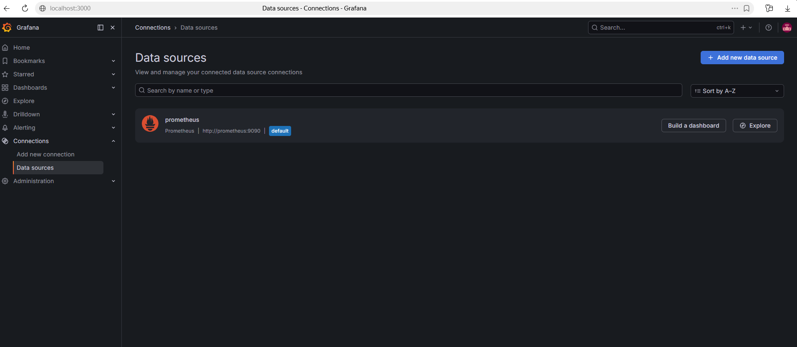
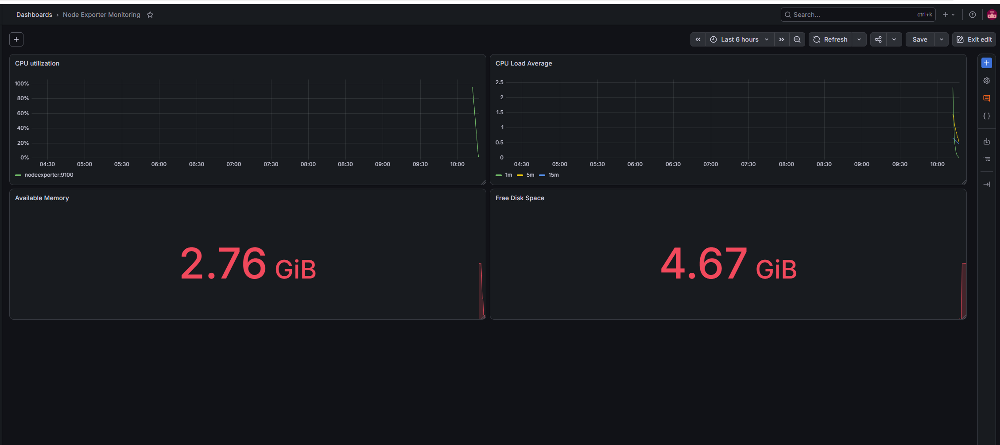
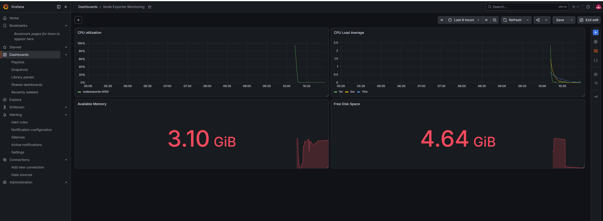

# Задачи

*1. скриншот веб-интерфейса grafana со списком подключенных Datasource.*



*2. Для решения этого задания приведите promql-запросы для выдачи этих метрик, а также скриншот получившейся Dashboard.*

`CPU utilization`:
```
100 - (
  avg by (instance) (
    rate(
      node_cpu_seconds_total{
        job="nodeexporter",
        mode="idle"
      }[5m]
    )
  ) * 100
)
```

`CPU Load Average`:
```
# 1m
node_load1{job="nodeexporter"}
# 5m
node_load5{job="nodeexporter"}
# 15m
node_load15{job="nodeexporter"}
```

`Available Memory`:
```
node_memory_MemAvailable_bytes{job="nodeexporter"}
```

`Free Disk Space`:
```
node_filesystem_avail_bytes{
  job="nodeexporter",
  mountpoint="/",
  fstype!~"tmpfs|overlay"
}
```



*3. В качестве решения задания приведите скриншот вашей итоговой Dashboard.*



*4. В качестве решения задания приведите листинг этого файла.*

```json
{
  "apiVersion": "dashboard.grafana.app/v2",
  "kind": "Dashboard",
  "metadata": {
    "name": "adn4vrc",
    "namespace": "default",
    "uid": "fb1d476e-9c0a-4740-9f27-a4c1ec147976",
    "resourceVersion": "1787642562777990",
    "generation": 5,
    "creationTimestamp": "2026-08-25T07:17:12Z",
    "labels": {
      "grafana.app/deprecatedInternalID": "2479048421793792"
    },
    "annotations": {
      "grafana.app/createdBy": "user:afw84jczigow0e",
      "grafana.app/message": "Node Exporter Monitoring",
      "grafana.app/saved-from-ui": "Grafana v13.1.4 (afdab62868)",
      "grafana.app/updatedBy": "user:afw84jczigow0e",
      "grafana.app/updatedTimestamp": "2026-08-25T07:22:42Z"
    }
  },
  "spec": {
    "annotations": [
      {
        "kind": "AnnotationQuery",
        "spec": {
          "query": {
            "kind": "DataQuery",
            "group": "grafana",
            "version": "v0",
            "datasource": {
              "name": "-- Grafana --"
            },
            "spec": {}
          },
          "enable": true,
          "hide": true,
          "iconColor": "rgba(0, 211, 255, 1)",
          "name": "Annotations & Alerts",
          "builtIn": true
        }
      }
    ],
    "cursorSync": "Off",
    "description": "Monitoring dashboard based on Prometheus and Node Exporter.",
    "editable": true,
    "elements": {
      "panel-1": {
        "kind": "Panel",
        "spec": {
          "id": 1,
          "title": "CPU utilization",
          "description": "",
          "links": [],
          "data": {
            "kind": "QueryGroup",
            "spec": {
              "queries": [
                {
                  "kind": "PanelQuery",
                  "spec": {
                    "query": {
                      "kind": "DataQuery",
                      "group": "prometheus",
                      "version": "v0",
                      "datasource": {
                        "name": "dfw84ql7c60hsc"
                      },
                      "spec": {
                        "editorMode": "code",
                        "expr": "100 - (\r\n  avg by (instance) (\r\n    rate(\r\n      node_cpu_seconds_total{\r\n        job=\"nodeexporter\",\r\n        mode=\"idle\"\r\n      }[5m]\r\n    )\r\n  ) * 100\r\n)",
                        "legendFormat": "__auto",
                        "range": true
                      }
                    },
                    "refId": "A",
                    "hidden": false
                  }
                }
              ],
              "transformations": [],
              "queryOptions": {}
            }
          },
          "vizConfig": {
            "kind": "VizConfig",
            "group": "timeseries",
            "version": "13.1.4",
            "spec": {
              "options": {
                "annotations": {
                  "clustering": -1,
                  "multiLane": false
                },
                "legend": {
                  "calcs": [],
                  "displayMode": "list",
                  "enableFacetedFilter": false,
                  "overflow": "ellipsis",
                  "placement": "bottom",
                  "showLegend": true
                },
                "tooltip": {
                  "hideZeros": false,
                  "mode": "single",
                  "sort": "none"
                }
              },
              "fieldConfig": {
                "defaults": {
                  "unit": "percent",
                  "thresholds": {
                    "mode": "absolute",
                    "steps": [
                      {
                        "value": 0,
                        "color": "green"
                      },
                      {
                        "value": 80,
                        "color": "#EAB839"
                      },
                      {
                        "value": 90,
                        "color": "red"
                      }
                    ]
                  },
                  "color": {
                    "mode": "palette-classic"
                  },
                  "custom": {
                    "axisBorderShow": false,
                    "axisCenteredZero": false,
                    "axisColorMode": "text",
                    "axisLabel": "",
                    "axisPlacement": "auto",
                    "barAlignment": 0,
                    "barWidthFactor": 0.6,
                    "drawStyle": "line",
                    "fillOpacity": 0,
                    "gradientMode": "none",
                    "hideFrom": {
                      "legend": false,
                      "tooltip": false,
                      "viz": false
                    },
                    "insertNulls": false,
                    "lineInterpolation": "linear",
                    "lineWidth": 1,
                    "pointSize": 5,
                    "scaleDistribution": {
                      "type": "linear"
                    },
                    "showPoints": "auto",
                    "showValues": false,
                    "spanNulls": false,
                    "stacking": {
                      "group": "A",
                      "mode": "none"
                    },
                    "thresholdsStyle": {
                      "mode": "off"
                    }
                  }
                },
                "overrides": []
              }
            }
          }
        }
      },
      "panel-2": {
        "kind": "Panel",
        "spec": {
          "id": 2,
          "title": "CPU Load Average",
          "description": "",
          "links": [],
          "data": {
            "kind": "QueryGroup",
            "spec": {
              "queries": [
                {
                  "kind": "PanelQuery",
                  "spec": {
                    "query": {
                      "kind": "DataQuery",
                      "group": "prometheus",
                      "version": "v0",
                      "datasource": {
                        "name": "dfw84ql7c60hsc"
                      },
                      "spec": {
                        "editorMode": "code",
                        "expr": "node_load1{job=\"nodeexporter\"}",
                        "legendFormat": "1m",
                        "range": true
                      }
                    },
                    "refId": "A",
                    "hidden": false
                  }
                },
                {
                  "kind": "PanelQuery",
                  "spec": {
                    "query": {
                      "kind": "DataQuery",
                      "group": "prometheus",
                      "version": "v0",
                      "datasource": {
                        "name": "dfw84ql7c60hsc"
                      },
                      "spec": {
                        "editorMode": "code",
                        "expr": "node_load5{job=\"nodeexporter\"}",
                        "instant": false,
                        "legendFormat": "5m",
                        "range": true
                      }
                    },
                    "refId": "B",
                    "hidden": false
                  }
                },
                {
                  "kind": "PanelQuery",
                  "spec": {
                    "query": {
                      "kind": "DataQuery",
                      "group": "prometheus",
                      "version": "v0",
                      "datasource": {
                        "name": "dfw84ql7c60hsc"
                      },
                      "spec": {
                        "editorMode": "code",
                        "expr": "node_load15{job=\"nodeexporter\"}",
                        "instant": false,
                        "legendFormat": "15m",
                        "range": true
                      }
                    },
                    "refId": "C",
                    "hidden": false
                  }
                }
              ],
              "transformations": [],
              "queryOptions": {}
            }
          },
          "vizConfig": {
            "kind": "VizConfig",
            "group": "timeseries",
            "version": "13.1.4",
            "spec": {
              "options": {
                "annotations": {
                  "clustering": -1,
                  "multiLane": false
                },
                "legend": {
                  "calcs": [],
                  "displayMode": "list",
                  "enableFacetedFilter": false,
                  "overflow": "ellipsis",
                  "placement": "bottom",
                  "showLegend": true
                },
                "tooltip": {
                  "hideZeros": false,
                  "mode": "single",
                  "sort": "none"
                }
              },
              "fieldConfig": {
                "defaults": {
                  "thresholds": {
                    "mode": "absolute",
                    "steps": [
                      {
                        "value": 0,
                        "color": "green"
                      },
                      {
                        "value": 80,
                        "color": "red"
                      }
                    ]
                  },
                  "color": {
                    "mode": "palette-classic"
                  },
                  "custom": {
                    "axisBorderShow": false,
                    "axisCenteredZero": false,
                    "axisColorMode": "text",
                    "axisLabel": "",
                    "axisPlacement": "auto",
                    "barAlignment": 0,
                    "barWidthFactor": 0.6,
                    "drawStyle": "line",
                    "fillOpacity": 0,
                    "gradientMode": "none",
                    "hideFrom": {
                      "legend": false,
                      "tooltip": false,
                      "viz": false
                    },
                    "insertNulls": false,
                    "lineInterpolation": "linear",
                    "lineWidth": 1,
                    "pointSize": 5,
                    "scaleDistribution": {
                      "type": "linear"
                    },
                    "showPoints": "auto",
                    "showValues": false,
                    "spanNulls": false,
                    "stacking": {
                      "group": "A",
                      "mode": "none"
                    },
                    "thresholdsStyle": {
                      "mode": "off"
                    }
                  }
                },
                "overrides": []
              }
            }
          }
        }
      },
      "panel-3": {
        "kind": "Panel",
        "spec": {
          "id": 3,
          "title": "Available Memory",
          "description": "",
          "links": [],
          "data": {
            "kind": "QueryGroup",
            "spec": {
              "queries": [
                {
                  "kind": "PanelQuery",
                  "spec": {
                    "query": {
                      "kind": "DataQuery",
                      "group": "prometheus",
                      "version": "v0",
                      "datasource": {
                        "name": "dfw84ql7c60hsc"
                      },
                      "spec": {
                        "editorMode": "code",
                        "expr": "node_memory_MemAvailable_bytes{job=\"nodeexporter\"}",
                        "legendFormat": "__auto",
                        "range": true
                      }
                    },
                    "refId": "A",
                    "hidden": false
                  }
                }
              ],
              "transformations": [],
              "queryOptions": {}
            }
          },
          "vizConfig": {
            "kind": "VizConfig",
            "group": "stat",
            "version": "13.1.4",
            "spec": {
              "options": {
                "colorMode": "value",
                "graphMode": "area",
                "justifyMode": "auto",
                "orientation": "auto",
                "percentChangeColorMode": "standard",
                "reduceOptions": {
                  "calcs": [
                    "lastNotNull"
                  ],
                  "fields": "",
                  "values": false
                },
                "showPercentChange": false,
                "textMode": "auto",
                "wideLayout": true
              },
              "fieldConfig": {
                "defaults": {
                  "unit": "bytes",
                  "thresholds": {
                    "mode": "absolute",
                    "steps": [
                      {
                        "value": 0,
                        "color": "green"
                      },
                      {
                        "value": 80,
                        "color": "red"
                      }
                    ]
                  },
                  "color": {
                    "mode": "thresholds"
                  }
                },
                "overrides": []
              }
            }
          }
        }
      },
      "panel-4": {
        "kind": "Panel",
        "spec": {
          "id": 4,
          "title": "Free Disk Space",
          "description": "",
          "links": [],
          "data": {
            "kind": "QueryGroup",
            "spec": {
              "queries": [
                {
                  "kind": "PanelQuery",
                  "spec": {
                    "query": {
                      "kind": "DataQuery",
                      "group": "prometheus",
                      "version": "v0",
                      "datasource": {
                        "name": "dfw84ql7c60hsc"
                      },
                      "spec": {
                        "editorMode": "code",
                        "expr": "node_filesystem_avail_bytes{\r\n  job=\"nodeexporter\",\r\n  mountpoint=\"/\",\r\n  fstype!~\"tmpfs|overlay\"\r\n}",
                        "legendFormat": "Free Disk Space",
                        "range": true
                      }
                    },
                    "refId": "A",
                    "hidden": false
                  }
                }
              ],
              "transformations": [],
              "queryOptions": {}
            }
          },
          "vizConfig": {
            "kind": "VizConfig",
            "group": "stat",
            "version": "13.1.4",
            "spec": {
              "options": {
                "colorMode": "value",
                "graphMode": "area",
                "justifyMode": "auto",
                "orientation": "auto",
                "percentChangeColorMode": "standard",
                "reduceOptions": {
                  "calcs": [
                    "lastNotNull"
                  ],
                  "fields": "",
                  "values": false
                },
                "showPercentChange": false,
                "textMode": "auto",
                "wideLayout": true
              },
              "fieldConfig": {
                "defaults": {
                  "unit": "bytes",
                  "thresholds": {
                    "mode": "absolute",
                    "steps": [
                      {
                        "value": 0,
                        "color": "green"
                      },
                      {
                        "value": 80,
                        "color": "red"
                      }
                    ]
                  },
                  "color": {
                    "mode": "thresholds"
                  }
                },
                "overrides": []
              }
            }
          }
        }
      }
    },
    "layout": {
      "kind": "GridLayout",
      "spec": {
        "items": [
          {
            "kind": "GridLayoutItem",
            "spec": {
              "x": 0,
              "y": 0,
              "width": 12,
              "height": 8,
              "element": {
                "kind": "ElementReference",
                "name": "panel-1"
              }
            }
          },
          {
            "kind": "GridLayoutItem",
            "spec": {
              "x": 12,
              "y": 0,
              "width": 12,
              "height": 8,
              "element": {
                "kind": "ElementReference",
                "name": "panel-2"
              }
            }
          },
          {
            "kind": "GridLayoutItem",
            "spec": {
              "x": 0,
              "y": 8,
              "width": 12,
              "height": 8,
              "element": {
                "kind": "ElementReference",
                "name": "panel-3"
              }
            }
          },
          {
            "kind": "GridLayoutItem",
            "spec": {
              "x": 12,
              "y": 8,
              "width": 12,
              "height": 8,
              "element": {
                "kind": "ElementReference",
                "name": "panel-4"
              }
            }
          }
        ]
      }
    },
    "links": [],
    "liveNow": false,
    "preload": false,
    "tags": [],
    "timeSettings": {
      "timezone": "browser",
      "from": "now-6h",
      "to": "now",
      "autoRefresh": "",
      "autoRefreshIntervals": [
        "5s",
        "10s",
        "30s",
        "1m",
        "5m",
        "15m",
        "30m",
        "1h",
        "2h",
        "1d"
      ],
      "hideTimepicker": false,
      "fiscalYearStartMonth": 0
    },
    "title": "Node Exporter Monitoring",
    "variables": [],
    "preferences": {
      "layout": {
        "kind": "GridLayout",
        "spec": {
          "items": []
        }
      }
    }
  }
}
```