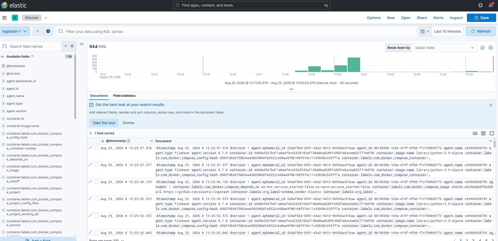

# Задачи

## Задача 1

*скриншот docker ps через 5 минут после старта всех контейнеров (их должно быть 5);*

```
CONTAINER ID   IMAGE                    COMMAND                  CREATED         STATUS         PORTS                                                                                                NAMES
c69960530795   elastic/filebeat:8.7.0   "/usr/bin/tini -- /u…"   5 minutes ago   Up 5 minutes                                                                                                        filebeat
9b7e8cdd8c8a   kibana:8.7.0             "/bin/tini -- /usr/l…"   5 minutes ago   Up 5 minutes   0.0.0.0:5601->5601/tcp, [::]:5601->5601/tcp                                                          kibana
0546985bef4d   logstash:8.7.0           "/usr/local/bin/dock…"   5 minutes ago   Up 5 minutes   0.0.0.0:5044->5044/tcp, [::]:5044->5044/tcp, 0.0.0.0:5046->5046/tcp, [::]:5046->5046/tcp, 9600/tcp   logstash
ee699f99c612   elasticsearch:8.7.0      "/bin/tini -- /usr/l…"   5 minutes ago   Up 5 minutes   0.0.0.0:9200->9200/tcp, [::]:9200->9200/tcp, 9300/tcp                                                es-hot
9ff845fa80a6   elasticsearch:8.7.0      "/bin/tini -- /usr/l…"   5 minutes ago   Up 5 minutes   9200/tcp, 9300/tcp                                                                                   es-warm
```

*скриншот интерфейса kibana;*


